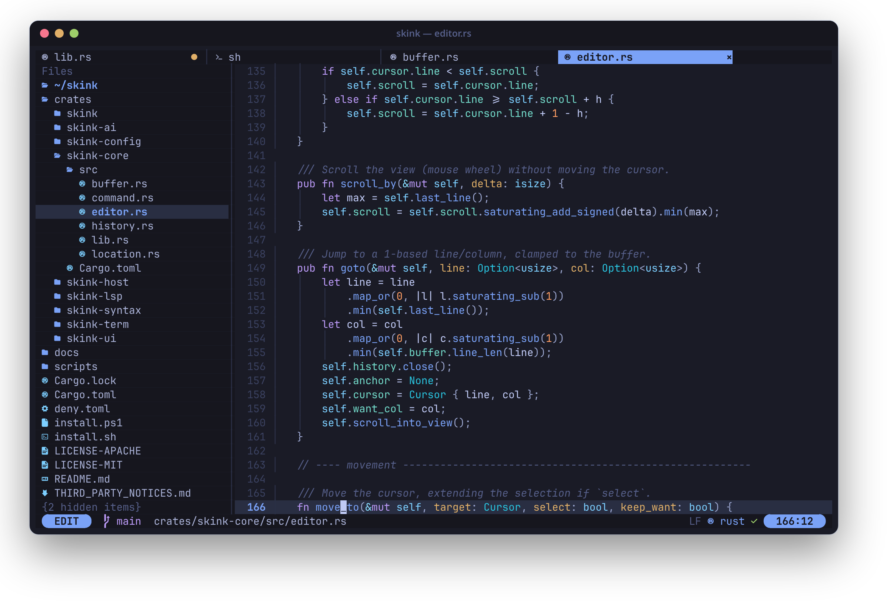
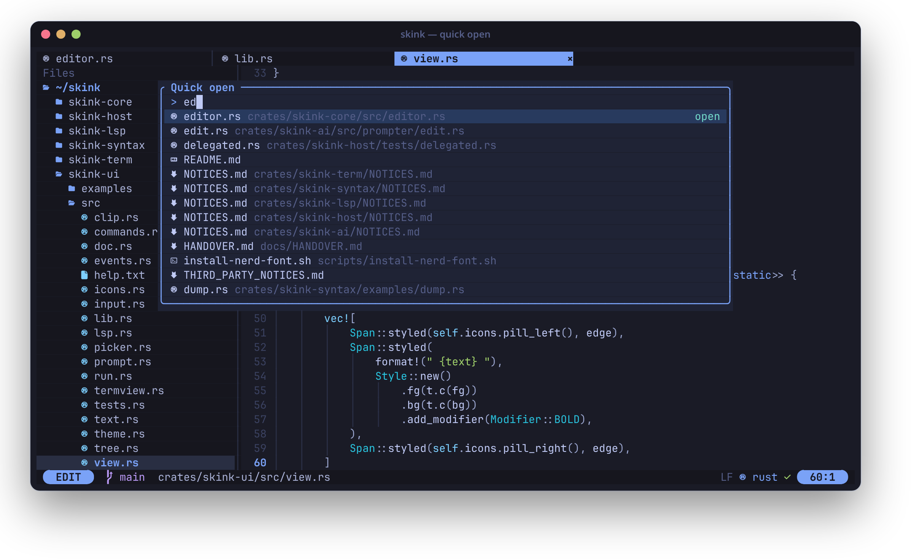
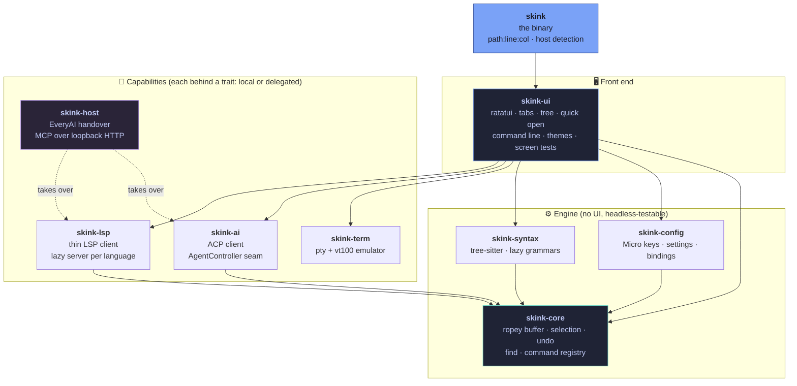

<div align="center">

<picture>
  <source media="(prefers-color-scheme: dark)" srcset="docs/readme/logo-dark.svg"/>
  
</picture>

**A modeless terminal editor with a seat for every AI agent.**<br/>
<sub>Micro's keys and config, tree-sitter highlighting, LSP diagnostics, a real terminal emulator in a tab, and an ACP client for coding agents. One static Rust binary, about 16 MB with 18 languages built in, that uses under 10 MB of RAM when idle.</sub>

<br/><br/>


<br/>


<a href="#-license"></a>

<br/><br/>

**[What it is](#-what-it-is) · [Install](#-install) · [Quick start](#-quick-start) · [Everything is a tab](#-everything-is-a-tab) · [AI agents](#-ai-agents) · [How it fits together](#-how-it-fits-together) · [Status](#-status) · [Develop](#-develop) · [Credits](#-credits)**

<br/><br/>



<sub>A real frame from the editor (Ghostty-style tab bar with file and terminal tabs, file tree, Tokyo Night, Nerd Font icons).</sub>

</div>


## ✦ What it is

Most terminal editors make you pick: the ease of `nano` or Micro, or the power of an IDE, or a modal language you have to learn first. Skink is going for the first with the second's features, and **no modes**. You type, you select with Shift and the mouse, Ctrl-S saves.

It is also built around a fact of how people code now: you run an agent in a terminal next to your file. So Skink has a **real terminal emulator as a tab**, and an **ACP client** so any agent (Claude Code, Gemini CLI, Goose and others) can attach to it.

It is small on purpose. No async runtime, no plugin host, no GUI toolkit. Every language server and grammar loads lazily, on first use.

- ⌨️ **Modeless, Micro-compatible.** Micro's default key bindings, Micro's `settings.json` / `bindings.json` formats. Your muscle memory carries over.
- 🌈 **tree-sitter highlighting** for Rust, TypeScript/JavaScript, Python, Go, Zig, JSON, TOML and Bash, in the Tokyo Night palette.
- 🩺 **LSP diagnostics** from a thin client that starts one server per language, only when you open that language.
- 🖥️ **A terminal in every tab bar.** Colours, mouse, alternate screen. F12 flips between your file and your shell.
- 🤖 **Agents as first-class citizens.** `:term claude` today, an ACP agent panel next, and a handover seam so a host like EveryAI can take over agent and LSP work.
- 🪶 **Light.** Measured on Linux: a 15.6 MB release binary, a first frame in 2–20 ms (most of it compiling the highlighter), about 8 MB of RAM when idle.

## ✦ Install

<table>
<tr><th width="18%">Platform</th><th>Command</th></tr>
<tr><td valign="top"><b>Linux · macOS</b></td><td>

```sh
curl -fsSL https://github.com/xuckless/skink/releases/latest/download/install.sh | sh
```

</td></tr>
<tr><td valign="top"><b>Windows</b><br/><sub>PowerShell 5.1+ or 7+</sub></td><td>

```powershell
irm https://github.com/xuckless/skink/releases/latest/download/install.ps1 | iex
```

</td></tr>
<tr><td valign="top"><b>From source</b><br/><sub>any OS, Rust 1.90+</sub></td><td>

```sh
cargo install --git https://github.com/xuckless/skink skink
```

</td></tr>
</table>

The installers download the right prebuilt binary for your machine (Linux x86_64 and aarch64 static musl, macOS Apple Silicon and Intel, Windows x86_64), **check its SHA-256** and refuse to install on a mismatch, then put it in `~/.local/bin` (`%LOCALAPPDATA%\Programs\skink\bin` on Windows). No `sudo`, no admin prompt. They add that folder to your `PATH` if it is missing.

```sh
skink --version                                       # check it worked
curl -fsSL https://github.com/xuckless/skink/releases/latest/download/install.sh | sh -s -- --uninstall
```

<details>
<summary><b>Installer options</b></summary>

| Variable | Effect |
|---|---|
| `SKINK_VERSION=v0.1.0` | Install a specific release instead of the latest |
| `SKINK_INSTALL_DIR=DIR` | Install somewhere else |
| `SKINK_NO_MODIFY_PATH=1` | Leave your shell startup files alone (`--no-modify-path` on Unix) |
| `SKINK_UNINSTALL=1` | PowerShell only: remove the binary and the `PATH` entry (Unix: `sh -s -- --uninstall`) |
| `SKINK_BASE_URL=URL` | Download from a mirror instead of GitHub |

Prefer to do it by hand? Grab `skink-<target>.tar.gz` (or `.zip` on Windows) and its `.sha256` from the [releases page](https://github.com/xuckless/skink/releases/latest), then verify with `shasum -a 256 -c`.

</details>

> [!NOTE]
> **The binaries are not code-signed yet.** The installers verify checksums, and on macOS they clear the quarantine flag for you. If you download an archive in a browser instead, macOS Gatekeeper may block it (`xattr -d com.apple.quarantine skink`) and Windows SmartScreen may warn (**More info**, then **Run anyway**).

**For the best look**, use a terminal with truecolor and a [Nerd Font](https://www.nerdfonts.com). `scripts/install-nerd-font.sh` installs one on Linux. No Nerd Font? Set `SKINK_ICONS=ascii`.

## ✦ Quick start

```sh
skink                    # empty scratch buffer
skink src/main.rs        # open a file
skink src/main.rs:42:7   # jump to line 42, column 7
skink .                  # open a folder: file tree on the left
```

| Key | Does | | Key | Does |
|---|---|---|---|---|
| <kbd>Ctrl</kbd>+<kbd>S</kbd> | Save | | <kbd>Alt</kbd>+<kbd>P</kbd> | Quick open (tabs, recent, project files) |
| <kbd>Ctrl</kbd>+<kbd>Q</kbd> | Close tab (quit on the last) | | <kbd>Ctrl</kbd>+<kbd>E</kbd> | Command line (`help` explains everything) |
| <kbd>Ctrl</kbd>+<kbd>Z</kbd> / <kbd>Y</kbd> | Undo / redo | | <kbd>F12</kbd> | Jump between your file and a terminal |
| <kbd>Ctrl</kbd>+<kbd>F</kbd> | Find (<kbd>Ctrl</kbd>+<kbd>N</kbd> / <kbd>P</kbd> next / previous) | | <kbd>Shift</kbd>+<kbd>F12</kbd> | Open another terminal |
| <kbd>Ctrl</kbd>+<kbd>C</kbd> / <kbd>X</kbd> / <kbd>V</kbd> | Copy / cut / paste (no selection copies the line) | | <kbd>F8</kbd> | File tree |
| <kbd>Alt</kbd>+<kbd>↑</kbd> / <kbd>↓</kbd> | Move line | | <kbd>Alt</kbd>+<kbd>1</kbd>…<kbd>9</kbd> | Jump to tab N |

The mouse works: click to place the cursor, drag to select, click a tab to switch, middle-click to close. Type `help` in the command line for the full tour and the complete key table.

## ✦ Everything is a tab

Files, terminals, help, diffs and command output all live in one tab bar, the way terminal-first people already work. Nothing opens a modal window you have to dismiss.

<p align="center"></p>

| Tab | How you get it | What it is |
|---|---|---|
| **File** | `skink FILE`, <kbd>Ctrl</kbd>+<kbd>O</kbd>, <kbd>Alt</kbd>+<kbd>P</kbd> | A rope-backed buffer with undo history, CRLF-safe saves, syntax colours, diagnostics and indent guides |
| **Terminal** | <kbd>Shift</kbd>+<kbd>F12</kbd>, `:term CMD` | A real terminal emulator in a pty. Its tab title follows the program inside, like Ghostty |
| **Help** | `:help [topic]` | The built-in manual, searchable like any other file |
| **Diff** | `:diff` | The working tree against git |
| **Conflicts** | `:conflicts` | Every conflicted file at its first marker. `:ours` / `:theirs` / `:both` resolve the block under the cursor, and it is undoable |
| **Run** | `:run CMD` | Command output, in a tab, not scrolled off your screen |
| **Settings** | `:settings`, `:bindings` | Micro-format JSON, created with defaults on first open. `:reload` applies it |

Config lives in `~/.config/skink` (or `$SKINK_CONFIG_DIR`). A binding can chain actions: `"Copy|CopyLine"` runs the first that works, `"Escape,Deselect"` runs both, and `"command-edit:goto "` opens the command line pre-filled.

## ✦ AI agents

Skink does not ship an agent. It gives yours a good place to run.

```sh
skink .
# Shift-F12 opens a terminal tab (F12 flips back to your file). In it:
claude            # or: gemini, opencode, goose ...
# or straight from the command line (Ctrl-E):
:term claude
```

Under that sits `skink-ai`, an [Agent Client Protocol](https://agentclientprotocol.com) client with no async runtime: one reader thread per agent, plus a prompter for the workflows you would want in an editor (rewrite a selection, search the project, one tracked worker task). The agent panel in the UI is the next piece. The wire subset and the seams are written up in [`docs/ACP.md`](docs/ACP.md).

### Running inside EveryAI

Every external capability in Skink (LSP, agents, terminals) sits behind a trait with two implementations: **local**, where Skink does the work, and **delegated**, where a host does it. When [EveryAI](https://github.com/xuckless/everyai-mono) starts Skink in its terminal it sets two environment variables, and Skink hands LSP and agent control over to it. It talks MCP over loopback HTTP, with nothing for you to configure. Without them, Skink runs standalone and never contacts anything.

| Variable | Meaning |
|---|---|
| `SKINK_HOST_URL` | The host's MCP endpoint, for example `http://127.0.0.1:41234/mcp` |
| `SKINK_HOST_TOKEN` | The bearer token for this session |

The full contract is in [`docs/HANDOVER.md`](docs/HANDOVER.md).

## ✦ How it fits together

Nine crates, split along the seams that matter. Dependencies point down, and `skink-core` never touches the UI, so the whole editing engine tests headless.



| Crate | What it owns |
|---|---|
| `skink-core` | Rope buffer on [ropey](https://github.com/cessen/ropey), selections, undo/redo history, CRLF-safe saves, find, and the Micro-style **command registry** that the palette, key bindings and (later) scripting all share |
| `skink-config` | Micro key names and Micro's default bindings, plus the settings and bindings file formats |
| `skink-syntax` | tree-sitter highlighting, one lazily loaded grammar per language |
| `skink-lsp` | A thin LSP client: JSON-RPC transport and server lifecycle, trimmed from [Lapce](https://github.com/lapce/lapce) |
| `skink-term` | The terminal pane: [portable-pty](https://github.com/wezterm/wezterm/tree/main/pty) plus a vendored `vt100`. Built to stand alone as its own crate |
| `skink-ai` | The ACP client, a 99-style prompter, and the `AgentController` seam |
| `skink-host` | The EveryAI handover: an MCP client over a plain loopback `TcpStream` |
| `skink-ui` | The ratatui front end, with screen-snapshot tests on a `TestBackend` |
| `skink` | The binary |

## ✦ Status

Skink is **alpha**. It is a real editor you can write code in today, and the bigger pieces are still landing.

| | |
|---|---|
| ✅ **Working** | Editing with multiple cursors, auto-pairs, smart indent, comment toggle, syntax-aware selection · find bar (regex, case, whole word, replace, in-selection) · atomic saves, external-change reload, crash backups · tabs for files, terminals, help and previews · quick open over the whole project, command palette, symbol search · file tree (create, rename, trash, filter, `.gitignore`) · tree-sitter highlighting for 18 languages with injections, parsed incrementally · LSP: diagnostics, completion with snippets, hover, signature help, go-to-definition, references, format, code actions, inlay hints · Markdown and SVG previews · `skink --upgrade` · AI: a 99-style prompt box (Ctrl-G) over ACP with model choice, an agent panel with permission prompts, and a **refactor preview** (checkboxes, per-file diff) for every multi-file change, including rename symbol · split panes, project-wide search and replace, session restore, folding, sticky scroll, rulers, docks, jump list · `:agents` with a health check on settings save · **git**: gutter change marks, stage / unstage / revert hunks with an inline peek, blame (inline and as a tab), a git panel (status, commit, branches, stash, push / pull in a terminal), side-by-side diff, clickable conflict resolution, status colours in the tree · EveryAI handover (tested against a fake host) |
| 🚧 **Next (v0.7)** | Structural refactors and tasks |
| 🧭 **Planned** | DAP (v0.8) · themes and scripting (v1.0) |

**Measured** on Linux, release build with fat LTO and `strip`, by `scripts/profile.py` in a real pty:

| | Result | Target |
|---|---|---|
| Binary | 15.6 MB (most of it tree-sitter grammars, which cost disk, not RAM) | under 20 MB |
| Start to first frame | 2.4 ms plain text · 10 ms Markdown · 20 ms Rust | under 50 ms |
| Idle RSS, project open | about 8 MB | under 15 MB |
| RSS with a 1 MB Rust file open | about 64 MB | under 120 MB |

`scripts/profile.py --budget` checks these in CI on every push.

These will be re-measured as LSP, the terminal and the agent panel grow, with CI budgets set from the real numbers.

## ✦ Develop

```sh
cargo test --workspace                                # unit + screen-snapshot tests
cargo clippy --workspace --all-targets -- -D warnings
cargo deny check                                      # licences: permissive only
scripts/measure.py [path]                             # cold start + peak RSS in a real pty (Linux/macOS)
```

CI runs on Linux, macOS and Windows. Releases are tag-driven: pushing `v*` builds all five targets, writes `SHA256SUMS`, publishes the GitHub release and then **installs it with the public one-liner on four OSes** to prove it works. `unsafe` is forbidden workspace-wide.

**Where the code comes from.** The rule is copy-first from permissive projects, and every adapted chunk carries a header naming its source, commit and changes. `cargo-deny` blocks GPL, AGPL and LGPL, and treats MPL-2.0 as banned. Zed (GPL/AGPL) and Helix (MPL-2.0) are design references only: no code, no query files. The full ledger is in [THIRD_PARTY_NOTICES.md](THIRD_PARTY_NOTICES.md).

## ✦ Credits

Skink stands on a lot of good work, most of it permissively licensed, and says so in the source:

[Micro](https://micro-editor.github.io) (key bindings and config formats) · [Lapce](https://lapce.dev) (LSP transport and lifecycle) · [ropey](https://github.com/cessen/ropey) · [ratatui](https://ratatui.rs) · [tree-sitter](https://tree-sitter.github.io) and [nvim-treesitter](https://github.com/nvim-treesitter/nvim-treesitter) queries · [lsp-types](https://github.com/gluon-lang/lsp-types) · [portable-pty](https://github.com/wezterm/wezterm/tree/main/pty) · [vt100](https://github.com/doy/vt100-rust) · [tui-textarea](https://github.com/rhysd/tui-textarea) (the undo-history idea) · [tui-term](https://github.com/a-kenji/tui-term) (the painting approach) · [Tokyo Night](https://github.com/folke/tokyonight.nvim) · the [Agent Client Protocol](https://agentclientprotocol.com). The prompter's shape is inspired by [ThePrimeagen/99](https://github.com/ThePrimeagen/99); it has no licence, so only the ideas were used, never the code.

An aside on the name: a skink is a small, quick lizard that sheds its tail to get away. Like [Anole](https://github.com/xuckless/anole), it is named for a lizard that's light on its feet. Built by [**@xuckless**](https://github.com/xuckless).

## ✦ License

Dual-licensed under [MIT](LICENSE-MIT) or [Apache-2.0](LICENSE-APACHE), at your option.


<div align="center">

<sub>Skink is part of the same family as <a href="https://github.com/xuckless/everyai-mono">EveryAI</a>, where it will be the default editor, and runs fine without it.<br/>Third-party notices ship in every release archive.</sub>

</div>
