<div align="center">

<picture>
  <source media="(prefers-color-scheme: dark)" srcset="docs/readme/logo-dark.svg"/>
  
</picture>

**The code editor for your terminal, without modes**

<a href="https://github.com/xuckless/skink/releases/latest"></a> <a href="https://github.com/xuckless/skink/actions/workflows/ci.yml"></a> <a href="#license"></a>

[Docs](https://skink.cc/docs/) · [Quick start](https://skink.cc/start/quick-start/) · [Compare](https://skink.cc/compare/) · [Releases](https://github.com/xuckless/skink/releases/latest)

</div>

## Install

```sh
curl -fsSL https://skink.cc/install.sh | sh      # Linux, macOS
```

```powershell
irm https://skink.cc/install.ps1 | iex           # Windows
```

No sudo. The installer checks the SHA-256 and puts one binary in your user folder. [Other ways to install](https://skink.cc/start/install/)

## Keys you already know

No insert mode, no motions to learn. Copy, paste, undo and save work the way they do everywhere else.



## Everything is a tab

Files, shells, diffs, your AI agent and the help share one tab bar. <kbd>F12</kbd> flips between the file and the shell.



## The same editor over SSH

One binary, no GUI, no server component. What you copy on the server lands on your own clipboard.



## Bring your own AI agent

Claude Code, Gemini CLI, Codex and others run in a tab or drive the editor directly. Their edits arrive as a diff you keep or drop.



## First steps

```sh
skink .                  # open a folder
skink src/main.rs:42     # open a file at line 42
```

<kbd>Ctrl</kbd>+<kbd>S</kbd> save · <kbd>Ctrl</kbd>+<kbd>Q</kbd> quit · <kbd>Alt</kbd>+<kbd>P</kbd> open a file · <kbd>Ctrl</kbd>+<kbd>E</kbd> command line · <kbd>F10</kbd> menus · <kbd>F12</kbd> terminal

Also inside: a settings screen, language servers, git hunks, blame and code review, a debugger, multiple cursors, soft wrap, project search, packages and Lua scripts. [Read the docs](https://skink.cc/docs/)

## Develop

```sh
cargo test --workspace
cargo clippy --workspace --all-targets -- -D warnings
cargo deny check
```

Code adapted from other projects says so in its header; the full list is in [THIRD_PARTY_NOTICES.md](THIRD_PARTY_NOTICES.md). Built on [Micro](https://micro-editor.github.io)'s keys, [ratatui](https://ratatui.rs), [ropey](https://github.com/cessen/ropey), [tree-sitter](https://tree-sitter.github.io), [Lapce](https://lapce.dev)'s LSP plumbing and the [Agent Client Protocol](https://agentclientprotocol.com).

## License

[MIT](LICENSE-MIT) or [Apache-2.0](LICENSE-APACHE), at your option.
